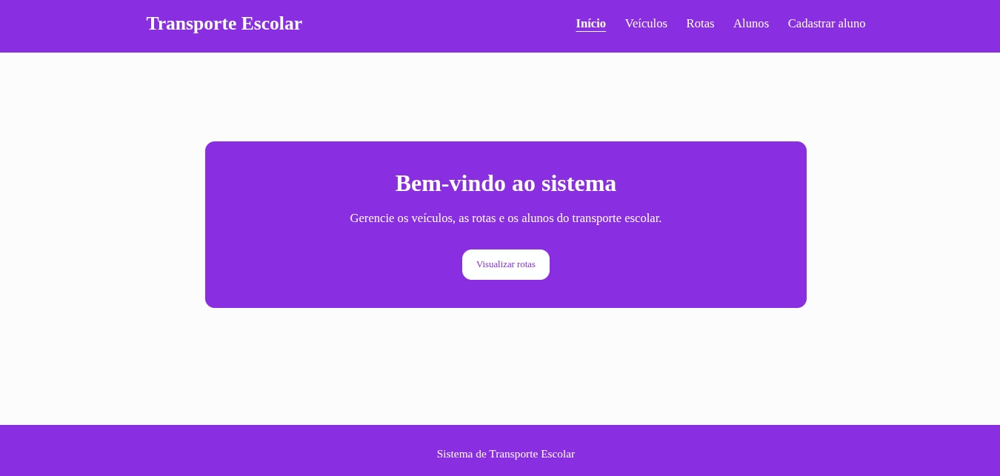
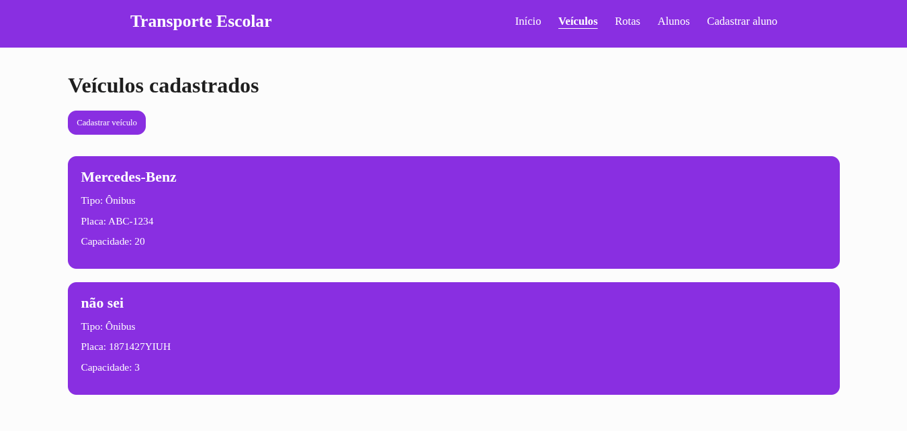
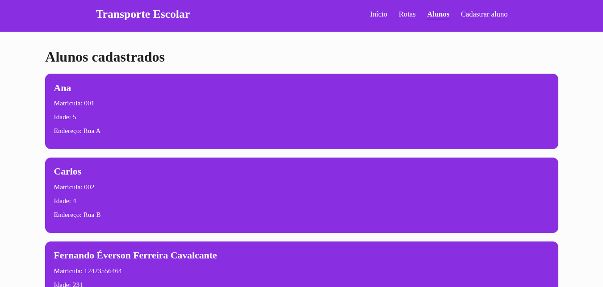
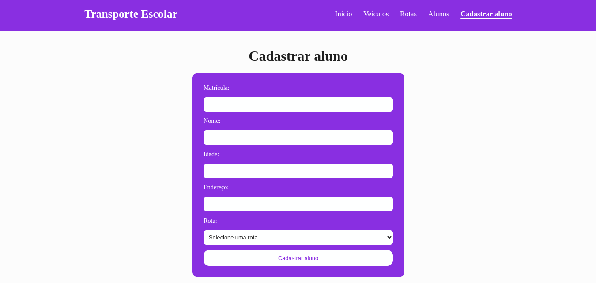
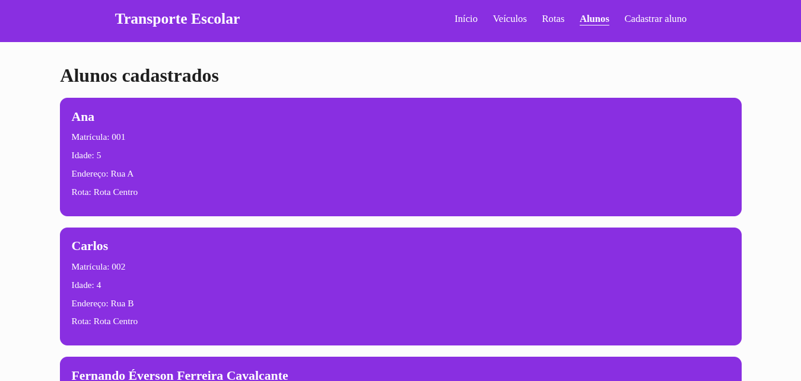

# Transporte Escolar

> Trabalho individual de Programação Web I — IFCE Campus Boa Viagem. Sistema web desenvolvido em PHP com Programação Orientada a Objetos.

**Autor:** Fernando Everson Ferreira Cavalcante  
**Tema:** 14 — Transporte Escolar  
**Vídeo de apresentação:** [[Adicionar link do vídeo](https://youtu.be/sOerLrDzXHI)]

## O problema

O transporte escolar precisa organizar informações sobre veículos, rotas e alunos. Sem um sistema de controle, torna-se mais difícil acompanhar quais veículos estão disponíveis, quais alunos pertencem a cada rota e quantas vagas ainda existem.

O sistema Transporte Escolar foi desenvolvido para reunir essas informações em uma aplicação web simples.

## Funcionalidades

- Cadastrar ônibus e vans, informando tipo, placa, modelo e capacidade.
- Consultar os veículos cadastrados.
- Cadastrar rotas e associá-las a veículos existentes.
- Consultar as rotas e seus respectivos veículos.
- Cadastrar alunos, informando matrícula, nome, idade, endereço e rota.
- Consultar todos os alunos e identificar suas rotas.
- Visualizar a ocupação dos veículos.
- Impedir cadastros inválidos por meio de regras de negócio.
- Armazenar os dados em um arquivo JSON.
- Disponibilizar os dados do sistema em formato JSON por meio de uma requisição GET.

## Tecnologias utilizadas

- PHP 8.3 ou superior
- HTML5
- CSS3
- JSON
- Git e GitHub

O sistema não utiliza banco de dados ou frameworks externos.

## Como executar

Clone o repositório:

```bash
git clone https://github.com/fernando-ferreira-caval/pweb1-trabalho-oo.git
```

Entre na pasta:

```bash
cd pweb1-trabalho-oo
```

Inicie o servidor PHP:

```bash
php -S localhost:8000 -t public
```

Acesse no navegador:

http://localhost:8000

Para executar os testes das classes:

```bash
php teste.php
```

Os dados são armazenados em `dados/sistema.json`. O PHP precisa ter permissão de escrita nesse arquivo e na pasta `dados/`.

## Organização do projeto

```text
pweb1-trabalho-oo/
├── dados/
│   └── sistema.json
├── docs/
│   ├── modelagem.md
│   ├── testes.md
│   ├── llm.md
│   └── relatorio.pdf
├── public/
│   ├── index.php
│   └── estilo.css
├── src/
│   ├── Aluno.php
│   ├── Veiculo.php
│   ├── Onibus.php
│   ├── Van.php
│   └── Rota.php
├── teste.php
└── README.md
```

## Páginas e rotas HTTP

| URL | Método | Funcionalidade |
|---|---|---|
| `/` | GET | Página inicial |
| `/?pagina=inicio` | GET | Página inicial |
| `/?pagina=veiculos` | GET | Listagem de veículos |
| `/?pagina=cadastro-veiculo` | GET e POST | Cadastro de veículos |
| `/?pagina=rotas` | GET | Listagem de rotas |
| `/?pagina=cadastro-rota` | GET e POST | Cadastro de rotas |
| `/?pagina=rota&id=centro` | GET | Detalhes da rota Centro |
| `/?pagina=alunos` | GET | Listagem de alunos |
| `/?pagina=cadastro` | GET e POST | Cadastro de alunos |
| `/?formato=json` | GET | Resposta JSON com veículos e rotas |
| `/?pagina=inexistente` | GET | Página inexistente, HTTP 404 |

As rotas cadastradas recebem identificadores próprios, utilizados para consultar seus detalhes.

## Classes e orientação a objetos

### Veiculo

Classe principal dos veículos, com os atributos privados `placa`, `modelo` e `capacidade`.

Possui construtor, getters, cálculo de lotação e conversão para array.

### Onibus e Van

Classes que herdam de `Veiculo`.

Utilizam `parent::__construct()` e sobrescrevem os métodos `calcularLotacao()` e `paraArray()`.

### Aluno

Representa um aluno do transporte escolar.

Possui matrícula, nome, idade e endereço, além dos métodos para consultar seus dados.

### Rota

Representa uma rota do transporte escolar.

Contém um objeto `Veiculo` e uma lista de objetos `Aluno`.

Permite adicionar alunos, consultar os participantes e calcular a ocupação.

## Regras de negócio

| Regra | Onde é aplicada |
|---|---|
| A capacidade do veículo deve ser maior que zero | `Veiculo::__construct()` |
| Não é permitido repetir a matrícula de um aluno na mesma rota | `Rota::adicionarAluno()` |
| Não é permitido ultrapassar a capacidade do veículo | `Rota::adicionarAluno()` |
| Não é permitido cadastrar veículos com placas repetidas | `public/index.php` |
| Não é permitido cadastrar rotas com nomes repetidos | `public/index.php` |
| Um veículo não pode ser associado a duas rotas | `public/index.php` |
| Não é permitido repetir a matrícula de um aluno no sistema | `public/index.php` |
| Um aluno deve ser associado a uma rota existente | `public/index.php` |

As regras utilizam exceções, tratadas com `try/catch` durante os cadastros.

## Persistência de dados

Os dados são armazenados no arquivo `dados/sistema.json`.

O sistema utiliza `json_encode()` para converter os dados em JSON e `file_put_contents()` para salvá-los.

Na leitura, utiliza `file_get_contents()` e `json_decode()` para reconstruir os objetos.

O arquivo contém duas coleções principais:

- `veiculos`: veículos cadastrados, identificados pela placa.
- `rotas`: rotas cadastradas, com veículo associado e lista de alunos.

O sistema também consegue ler o formato anterior, no qual os veículos estavam armazenados apenas dentro das rotas.

## Segurança e validação

O sistema utiliza:

- `declare(strict_types=1)` nos arquivos PHP das classes.
- Atributos privados para encapsulamento.
- `filter_var()` para validar números inteiros recebidos dos formulários.
- `htmlspecialchars()` para escapar informações exibidas no HTML.
- `try/catch` para tratar exceções.
- Verificação de páginas e identificadores de rotas inexistentes.
- `JSON_THROW_ON_ERROR` durante a leitura e gravação dos dados.

## Telas












## Documentação

- [Modelagem e diagrama de classes](docs/modelagem.md)
- [Roteiro de testes](docs/testes.md)
- [Diário de uso de LLM](docs/llm.md)
- [Relatório final](docs/relatorio.pdf)

## Ferramentas de desenvolvimento

| Ferramenta | Utilização |
|---|---|
| VS Code | Desenvolvimento e edição do código |
| PHP | Lógica de programação, classes e servidor local |
| Git | Controle de versões |
| GitHub | Hospedagem do repositório |
| curl | Testes de requisições HTTP |
| Navegador | Testes da interface |
| ChatGPT | Apoio na implementação, revisão e documentação |
