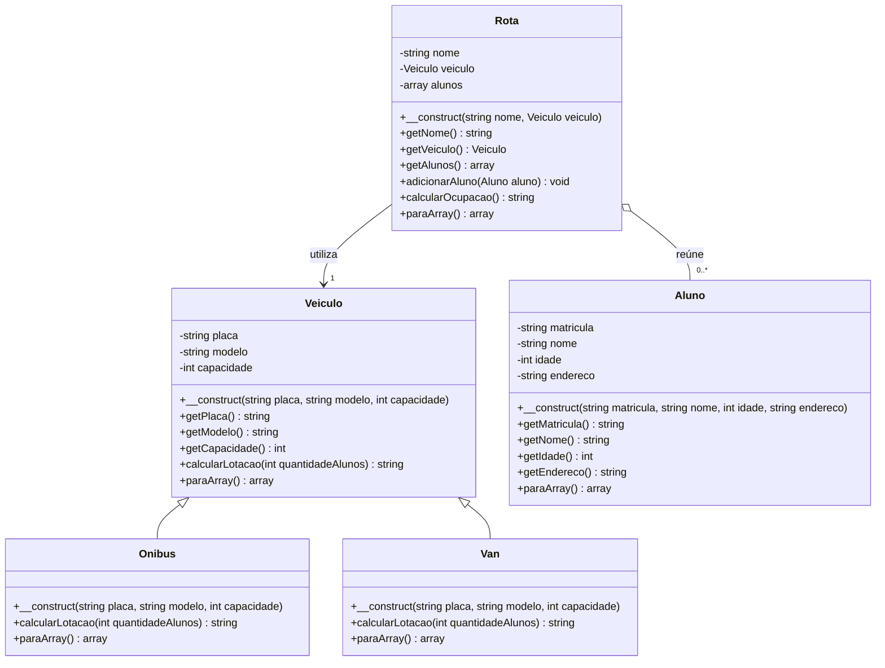

# Modelagem do sistema Transporte Escolar

## Visão geral

O sistema utiliza cinco classes principais:

- `Veiculo`
- `Onibus`
- `Van`
- `Aluno`
- `Rota`

A modelagem representa veículos utilizados no transporte escolar, alunos cadastrados e rotas responsáveis por organizar esses alunos.

## Diagrama de classes



## Herança

A classe `Veiculo` funciona como classe mãe.

As classes `Onibus` e `Van` utilizam `extends Veiculo` para herdar seus atributos e comportamentos.

Isso evita repetir a implementação de placa, modelo, capacidade e seus respectivos métodos de consulta.

Os construtores das classes filhas utilizam `parent::__construct()`.

## Polimorfismo

As classes `Onibus` e `Van` sobrescrevem o método `calcularLotacao()`.

As duas classes possuem o mesmo método, mas apresentam o resultado com a identificação do tipo de veículo.

Exemplos:

```text
Ônibus: 2/20 vagas ocupadas
Van: 3/8 vagas ocupadas
```

A classe `Rota` recebe um objeto do tipo `Veiculo`, podendo trabalhar tanto com um ônibus quanto com uma van.

Ao chamar `calcularOcupacao()`, a rota utiliza o método do veículo associado.

## Associação entre rota e veículo

Cada objeto `Rota` mantém uma referência para um objeto `Veiculo`.

O veículo é criado independentemente e depois selecionado no cadastro da rota.

Por isso, a relação é representada como associação no diagrama.

Na camada web, existe uma regra adicional que impede associar o mesmo veículo a duas rotas.

## Composição de objetos

A classe `Rota` também mantém uma lista de objetos `Aluno`.

Os alunos são adicionados pelo método `adicionarAluno()`.

Essa estrutura permite que a rota organize seus participantes e calcule a ocupação a partir da quantidade de alunos cadastrados.

A relação com os alunos é representada como agregação no diagrama, pois os alunos são objetos que podem ser criados independentemente da rota.

## Encapsulamento

Os atributos das classes são privados, utilizando `private`.

O acesso às informações acontece por meio de métodos públicos, como:

- `getPlaca()`
- `getCapacidade()`
- `getMatricula()`
- `getAlunos()`
- `getVeiculo()`

Não foram implementados setters, pois os objetos recebem seus dados na construção e o sistema não possui funcionalidade de edição desses atributos.

## Regras de negócio

### Capacidade válida

A classe `Veiculo` rejeita capacidade inferior a um.

### Matrícula duplicada na rota

A classe `Rota` verifica se já existe um aluno com a mesma matrícula antes de adicioná-lo.

### Limite de vagas

A classe `Rota` compara a quantidade de alunos com a capacidade do veículo.

Caso o limite seja atingido, uma exceção é lançada.

### Validações dos cadastros web

O arquivo `public/index.php` também verifica:

- Placas de veículos duplicadas.
- Nomes de rotas repetidos.
- Veículos já associados a outras rotas.
- Matrículas repetidas entre rotas.
- Existência da rota selecionada pelo usuário.

## Conversão para array

Todas as classes implementam `paraArray()`.

Esse método permite representar os objetos como arrays associativos.

A classe `Rota` utiliza os métodos `paraArray()` dos objetos associados para produzir uma estrutura completa com dados da rota, veículo, alunos e ocupação.

## Persistência

O arquivo `dados/sistema.json` armazena os dados do sistema.

A estrutura principal possui duas coleções:

```json
{
    "veiculos": {
        "ABC-1234": {
            "placa": "ABC-1234",
            "modelo": "Mercedes-Benz",
            "capacidade": 20,
            "tipo": "Ônibus"
        }
    },
    "rotas": {
        "centro": {
            "nome": "Rota Centro",
            "veiculo": {
                "placa": "ABC-1234",
                "modelo": "Mercedes-Benz",
                "capacidade": 20,
                "tipo": "Ônibus"
            },
            "alunos": [],
            "ocupacao": "Ônibus: 0/20 vagas ocupadas"
        }
    }
}
```

Esse exemplo demonstra o formato dos dados, não necessariamente o conteúdo atual do arquivo.

Durante o carregamento, o sistema reconstrói os objetos das classes a partir dos dados armazenados.

## Organização da lógica

As classes estão separadas na pasta `src/`.

O arquivo `public/index.php` é responsável pelo carregamento dos dados, processamento dos formulários, navegação e apresentação das páginas.

A lógica PHP é executada antes do HTML, permitindo processar as requisições e preparar as informações utilizadas na interface.
