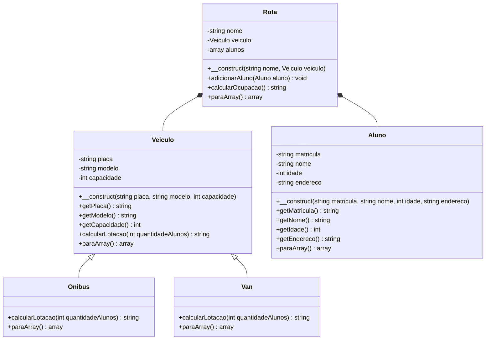

# Modelagem

## Diagrama de classes

Legenda: `<|--` herança ("é um"), `*--` composição ("tem um"), `-` private, `+` public.

## Justificativas

### Herança

A classe `Veiculo` é a classe mãe. As classes `Onibus` e `Van` são suas filhas, pois um ônibus é um veículo e uma van também é um veículo.

As duas classes sobrescrevem o método `calcularLotacao()`, permitindo que cada tipo de veículo apresente sua própria implementação.

### Composição

A classe `Rota` possui um objeto `Veiculo` e uma lista de objetos `Aluno`.

Essa relação representa composição porque uma rota possui um veículo e reúne os alunos que fazem parte dela.

O método `adicionarAluno()` permite incluir alunos na rota, enquanto `calcularOcupacao()` calcula sua ocupação utilizando o veículo associado.

### Encapsulamento

Todas as classes possuem atributos privados (`private`), impedindo o acesso direto aos seus valores.

A classe `Veiculo` possui getters para consultar placa, modelo e capacidade. A classe `Aluno` também possui getters para consultar matrícula, nome, idade e endereço.

Não foram criados setters porque os dados são definidos durante a construção dos objetos e não precisam ser alterados diretamente.